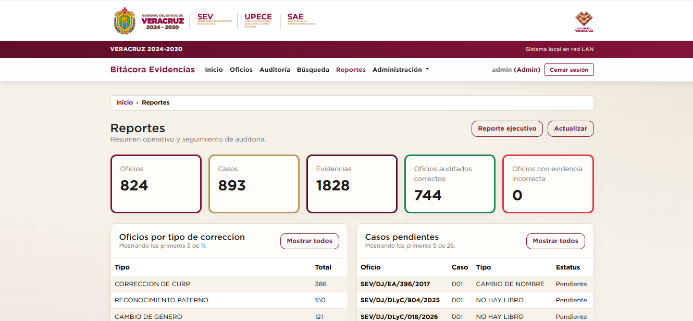

# Bitacora Evidencias

Aplicacion ASP.NET Core Razor Pages para gestionar oficios, casos de correccion, evidencias fotograficas, auditoria y reportes en una red local.

**0.2.0 usa SQL Server Express 2025 y sigue en preparacion. Produccion conserva SQLite 0.1.0.** El codigo SQLite esta congelado en `v0.1.0` y `archive/sqlite-0.1`; las nuevas funcionalidades se desarrollan en `feature/sqlserver-0.2`. Git conserva codigo; datos, fotografias y secretos requieren respaldos externos.

Consulta el [indice documental](docs/INDEX.md) y el [estado de aceptacion](docs/ESTADO-0.2.0.md) antes de ejecutar procedimientos. La version SQL todavia no sustituye produccion.

## Funcionalidades

- Autenticacion con cookies, roles Admin/Capturista, bloqueo y cambio de contrasena temporal.
- Oficios con cero, uno o dos casos: maximo uno de Primaria y uno de Secundaria.
- Fotografias, miniaturas y enlaces de evidencia; almacenamiento de archivos separado de SQL.
- Busquedas, revision de auditoria, reportes e importaciones CSV/XLSX con vista previa.
- Administracion de usuarios y bitacora de acciones.
- Validacion al salir del campo, errores junto al control, resumen toast y confirmaciones con librerias locales.
- Cifrado aplicativo con llave externa, busquedas protegidas y conservacion de historicos incompletos.
- Respaldo SQL verificado, historicos de auditoria y monitoreo con PowerShell.



## Requisitos y configuracion

El proyecto fija SDK .NET `9.0.319` con `latestPatch` en `global.json`. Usa EF Core 9, SQL Server Express 2025, Windows/PowerShell para operacion y procesamiento de imagenes, y un navegador moderno. Bootstrap, HTMX y jQuery Validation se incluyen localmente; no se necesita npm para ejecutar la aplicacion.

```powershell
dotnet restore
dotnet build tools/BitacoraMigration/BitacoraMigration.csproj -c Release
```

`appsettings.json` deja vacia la conexion SQL. Configurar externamente:

| Variable | Uso |
| --- | --- |
| `ConnectionStrings__DefaultConnection` | Conexion SQL cifrada; credenciales suministradas localmente. |
| `BITACORA_DATA_PROTECTION_KEY` | Misma llave existente para conservar lectura de datos/evidencias. Obligatoria en 0.2.0. |
| `Storage__RootPath` | Carpeta de evidencias de la instalacion o de su copia de ensayo. |
| `BITACORA_HTTPS_CERT_PATH`, `BITACORA_HTTPS_CERT_PASSWORD` | Certificado HTTPS existente y contrasena. |
| `BITACORA_BACKUP_ROOT` | Destino de respaldos. |
| `BITACORA_BACKUP_SQL_STAGING`, `BITACORA_BACKUP_SQL_CREDENTIAL_FILE` | Intercambio del BAK y credencial DPAPI de respaldo. |
| `BITACORA_OPERATIONS_SQL_CREDENTIAL_FILE` | Credencial DPAPI de auditoria/monitoreo. |

[.env.example](.env.example) contiene placeholders. Copiarlo a `.env` no carga las variables automaticamente; tampoco se carga `appsettings.Local.json` por defecto. No guardar secretos en archivos versionados ni regenerar la llave existente.

## Ensayo SQL

La instancia prevista es `.\Auditoria`; `BitacoraEvidencias_Pruebas` ya contiene la importacion y escrituras del ensayo. No repetir import sobre ella. El proceso completo y la preparacion de una copia nueva estan en [ENSAYO-SQLSERVER.md](docs/ENSAYO-SQLSERVER.md).

Publicar siempre en una carpeta nueva para conservar binarios anteriores:

```powershell
powershell.exe -NoProfile -ExecutionPolicy Bypass -File scripts/deploy/Publish-BitacoraSqlServer.ps1 -AppFolder App-revision-docs
powershell.exe -NoProfile -ExecutionPolicy Bypass -File scripts/deploy/Start-BitacoraSqlServer.ps1 -AppFolder App-revision-docs
```

El lanzador solicita credenciales SQL, usa la copia de evidencias y el puerto HTTPS **5068**. Detener solo el ensayo anterior antes de arrancar otro. El certificado debe cubrir el nombre/direccion usado. `-TrustLocalSqlCertificate` permite explicitamente el certificado SQL local sin cadena de confianza, manteniendo cifrado; no cambia la confianza HTTPS.

No ejecutar los scripts SQLite de inicializacion, stamp, publicacion o arranque desde esta rama para preparar SQL. El arranque 0.2.0 bloquea esas opciones y exige esquema preparado y usuarios migrados.

## Operacion acordada

| Tarea | Hora de Mexico | Politica |
| --- | --- | --- |
| Monitoreo | 09:15 | SQL, HTTP, disco, evidencias, respaldo y conteos de eventos. |
| Archivado | 09:20 | 30 dias en SQL; anteriores en archivos sin caducidad automatica. |
| Respaldo | 14:00 | Cierre ordenado, BAK/evidencias/historicos verificados y reinicio. |

Los registradores preparan tareas SQL deshabilitadas; actualmente no estan registradas ni activadas. Las tareas SQLite siguen intactas hasta la migracion. Las nuevas tareas requieren sesion Windows abierta; puede estar bloqueada. Ver [operacion](docs/OPERATIONS.md), [respaldo](docs/BACKUP-OPERACION.md) y [auditoria/monitoreo](docs/AUDITORIA-MONITOREO-0.2.0.md).

## Pruebas

```powershell
dotnet test tests/BitacoraEvidencias.Web.Tests/BitacoraEvidencias.Web.Tests.csproj -c Release
powershell.exe -NoProfile -ExecutionPolicy Bypass -File scripts/validation/Test-SqlServerConnectionScripts.ps1
powershell.exe -NoProfile -ExecutionPolicy Bypass -File scripts/validation/Test-SqlBackup.ps1
powershell.exe -NoProfile -ExecutionPolicy Bypass -File scripts/validation/Test-SqlOperations.ps1
```

Hay seis fallos conocidos de almacenamiento/preparacion SQLite en la ultima suite completa; no declarar una liberacion aprobada con esos resultados. Las pruebas operativas SQL, restauracion y DOM tienen resultados separados. Detalles y limites en [TESTING.md](docs/TESTING.md).

## Estructura

| Carpeta | Contenido |
| --- | --- |
| Data | Contexto base, contexto SQL y migraciones separadas por proveedor. |
| Pages, ViewComponents | Flujos Razor Pages y panel principal. |
| Services, Security, Validation | Negocio, archivos, cifrado, auditoria y reglas. |
| wwwroot | Interfaz y librerias locales. |
| scripts | Migracion, ensayo, respaldo, monitoreo y procedimientos SQLite conservados. |
| tools/BitacoraMigration | Preflight, importacion, verificacion, indices y diagnostico. |
| tests, docs | Pruebas y documentacion. |

## Seguridad y versionado

No versionar bases, BAK, fotografias, historicos, logs, credenciales DPAPI, certificados ni llaves. No publicar datos personales en issues o reportes. El respaldo SQL no incluye la llave ni el certificado; mantener su custodia externa. Ver [seguridad](docs/SECURITY.md), [privacidad](docs/PRIVACY-DATA.md) y [revision antes de GitHub](docs/GITHUB-PUBLISH-CHECKLIST.md).

Conservar `v0.1.0`; no moverla ni recrearla. No crear `v0.2.0` hasta aprobar pruebas y el cambio. Version declarada en [BitacoraEvidencias.Web.csproj](BitacoraEvidencias.Web.csproj); cambios en [CHANGELOG.md](CHANGELOG.md). Consultar [SQLite conservada](docs/SQLITE-0.1.md) sin cambiar la carpeta utilizada por el acceso directo productivo.

La migracion final requiere una copia reciente consistente, aceptacion de formularios, permisos SQL de operacion, custodia de secretos y procedimiento de despliegue productivo. Volver a SQLite despues de aceptar escrituras nuevas en SQL exige conciliarlas; arrancar la base antigua no conserva esos cambios.

Licencia MIT: [LICENSE](LICENSE).
